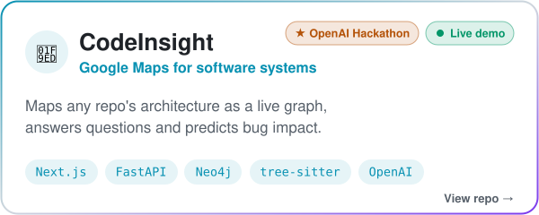
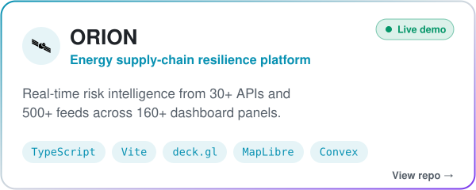
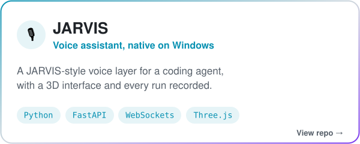
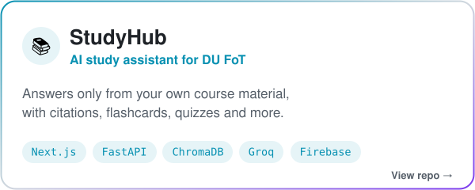
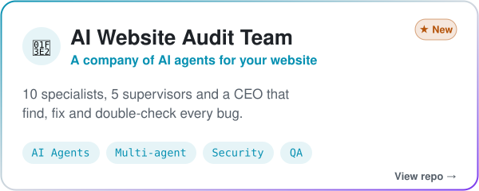
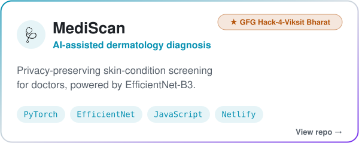
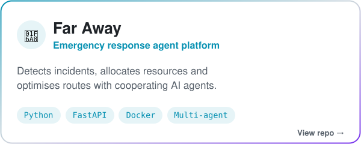

<picture>
  <source media="(prefers-color-scheme: dark)" srcset="assets/header-dark.svg">
  
</picture>

  <picture>
    <source media="(prefers-color-scheme: dark)" srcset="assets/typing-dark.svg">
    
  </picture>

  
  
  

<picture>
  <source media="(prefers-color-scheme: dark)" srcset="assets/divider-dark.svg">
  
</picture>

## 👨‍💻 About me

- 🎓 **B.Tech (1st year)** at the **Faculty of Technology, University of Delhi**
- 🤖 I build **AI agents** and the **full-stack apps** around them: voice assistants, codebase intelligence, multi-agent systems
- 🏆 **Hackathons:** OpenAI Hackathon (*CodeInsight*) · GFG Hack-4-Viksit Bharat (*MediScan*, team project)
- 🌱 **Currently sharpening:** C (daily practice) and training vision models with PyTorch
- 💬 **Ask me about:** AI agents, RAG, FastAPI, Next.js
- 📫 **Reach me:** [LinkedIn](https://www.linkedin.com/in/nishant1600/) or [nishantsharmadks@gmail.com](mailto:nishantsharmadks@gmail.com)

## 🛠️ Tech stack

<b>Languages</b>  
  <picture>
    <source media="(prefers-color-scheme: dark)" srcset="https://skillicons.dev/icons?i=py,ts,js,html,css,c,postgres&theme=dark">
    
  </picture>

<b>Frameworks &amp; tools</b>  
  <picture>
    <source media="(prefers-color-scheme: dark)" srcset="https://skillicons.dev/icons?i=react,nextjs,tailwind,vite,threejs,fastapi,nodejs,firebase,docker,git,vercel,netlify&theme=dark">
    
  </picture>

<b>AI &amp; ML</b>  
  <picture>
    <source media="(prefers-color-scheme: dark)" srcset="https://skillicons.dev/icons?i=pytorch,sklearn&theme=dark">
    
  </picture>
    
  
  
  
  

<picture>
  <source media="(prefers-color-scheme: dark)" srcset="assets/divider-dark.svg">
  
</picture>

## 🚀 Featured projects

  <a href="https://github.com/Nishant1600/Codeinsight"><picture><source media="(prefers-color-scheme: dark)" srcset="assets/cards/codeinsight-dark.svg"></picture></a>
  <a href="https://github.com/Nishant1600/ORION"><picture><source media="(prefers-color-scheme: dark)" srcset="assets/cards/orion-dark.svg"></picture></a>
  <a href="https://github.com/Nishant1600/BrainstormingJARVIS"><picture><source media="(prefers-color-scheme: dark)" srcset="assets/cards/jarvis-dark.svg"></picture></a>
  <a href="https://github.com/Nishant1600/studyhub"><picture><source media="(prefers-color-scheme: dark)" srcset="assets/cards/studyhub-dark.svg"></picture></a>
  <a href="https://github.com/Nishant1600/ai-website-audit-team"><picture><source media="(prefers-color-scheme: dark)" srcset="assets/cards/audit-team-dark.svg"></picture></a>
  <a href="https://github.com/Nishant1600/GFG-MEDISCAN"><picture><source media="(prefers-color-scheme: dark)" srcset="assets/cards/mediscan-dark.svg"></picture></a>
  <a href="https://github.com/Nishant1600/Far_AWAY"><picture><source media="(prefers-color-scheme: dark)" srcset="assets/cards/far-away-dark.svg"></picture></a>

  
  

<picture>
  <source media="(prefers-color-scheme: dark)" srcset="assets/divider-dark.svg">
  
</picture>

## 🏹 Contribution hunt

  <picture>
    <source media="(prefers-color-scheme: dark)" srcset="https://raw.githubusercontent.com/Nishant1600/Nishant1600/output/archer-dark.svg">
    
  </picture>

  <picture>
    <source media="(prefers-color-scheme: dark)" srcset="https://streak-stats.demolab.com?user=Nishant1600&background=0D1117&border=283044&ring=22D3EE&fire=FBBF24&currStreakNum=E6EDF3&sideNums=E6EDF3&currStreakLabel=22D3EE&sideLabels=8B949E&dates=8B949E&stroke=283044">
    
  </picture>

<picture>
  <source media="(prefers-color-scheme: dark)" srcset="assets/divider-dark.svg">
  
</picture>

<h3 align="center">🤝 Let's build something together</h3>

  Always happy to talk about AI agents, projects and collaborations. 
  <a href="https://www.linkedin.com/in/nishant1600/">LinkedIn</a> · <a href="mailto:nishantsharmadks@gmail.com">Email</a>

