

  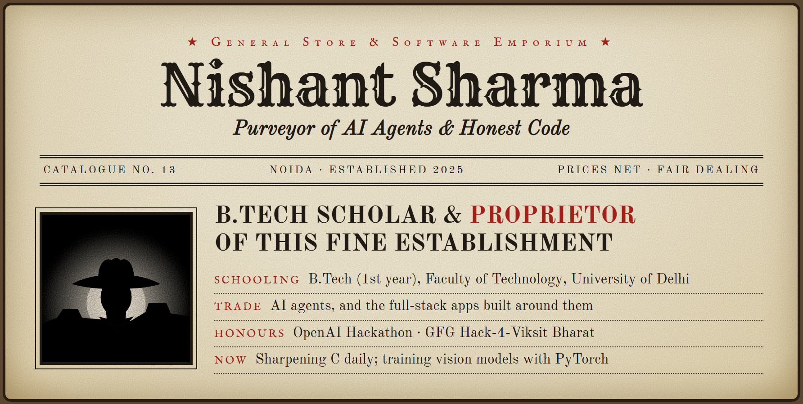

  
  
  

  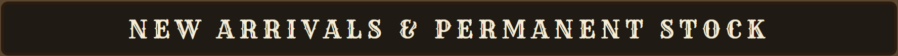

  <a href="https://github.com/Nishant1600/Codeinsight">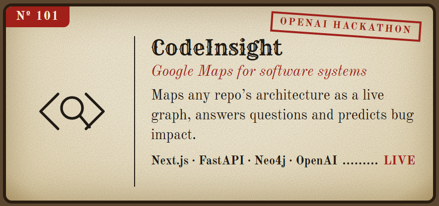</a>
  <a href="https://github.com/Nishant1600/ORION">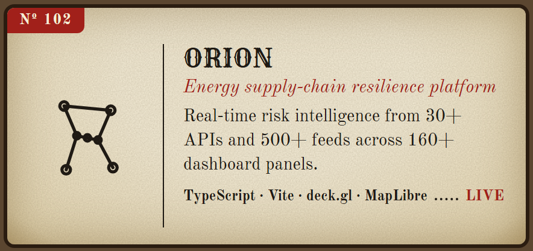</a>
  <a href="https://github.com/Nishant1600/BrainstormingJARVIS">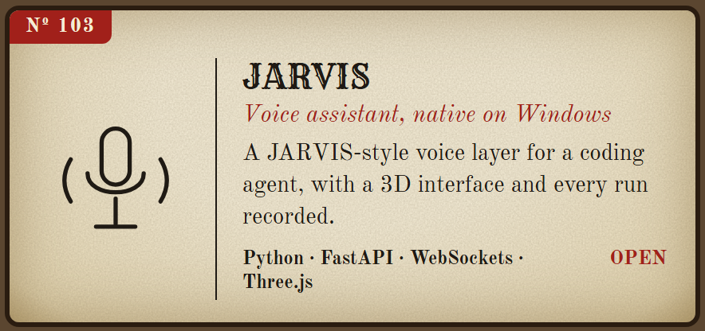</a>
  <a href="https://github.com/Nishant1600/studyhub">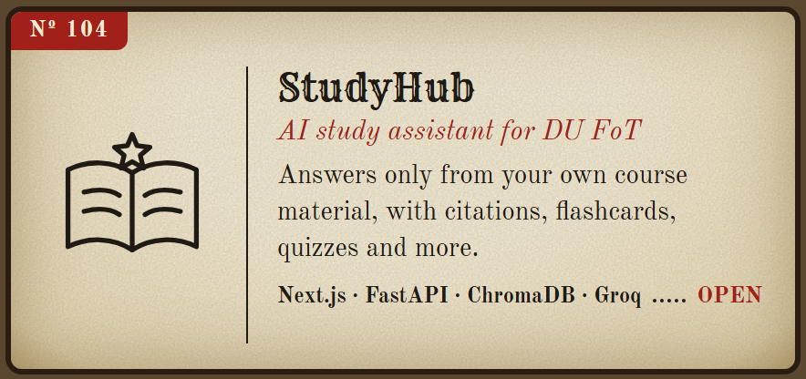</a>
  <a href="https://github.com/Nishant1600/ai-website-audit-team">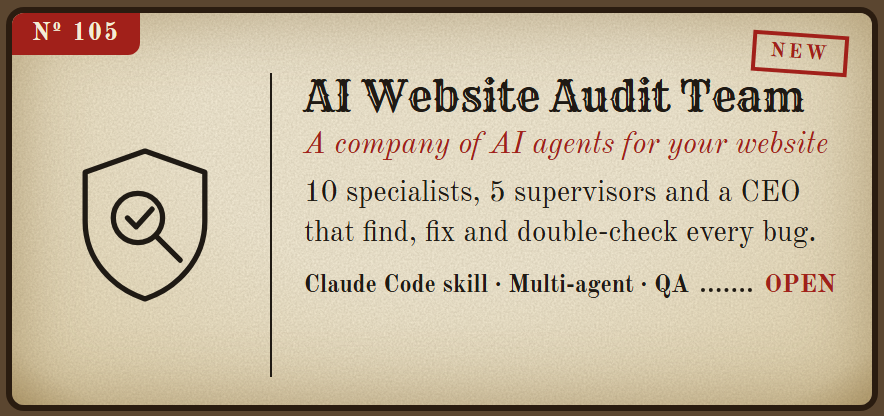</a>
  <a href="https://github.com/Nishant1600/GFG-MEDISCAN">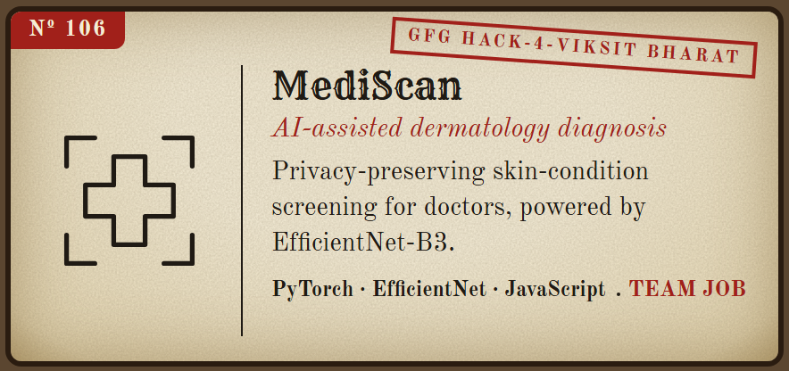</a>
  <a href="https://github.com/Nishant1600/Far_AWAY">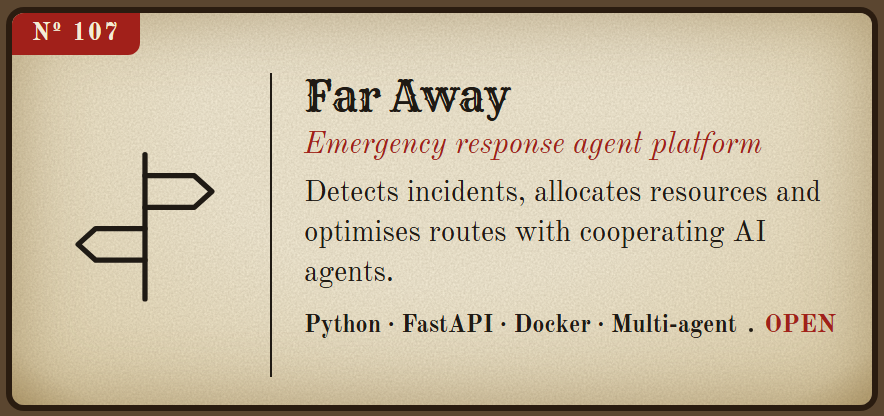</a>
  <a href="https://github.com/Nishant1600/Learning-C">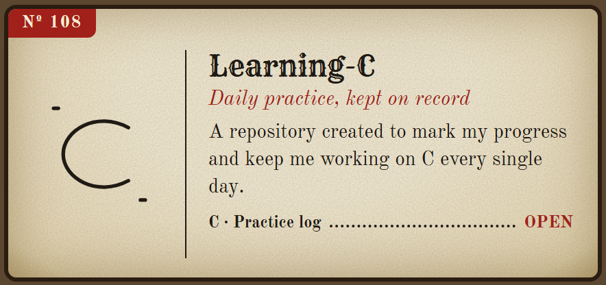</a>

  
  

  

  

  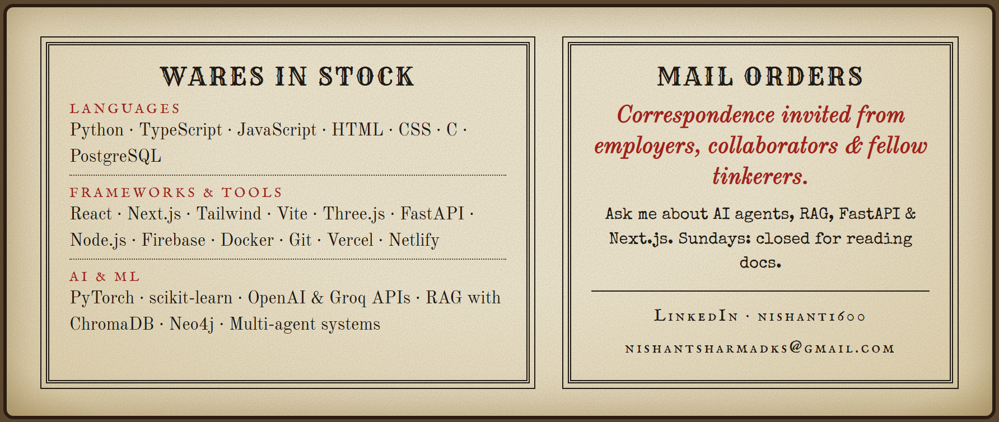

  

  <a href="https://www.linkedin.com/in/nishant1600/">LinkedIn</a> · <a href="mailto:nishantsharmadks@gmail.com">Email</a>

