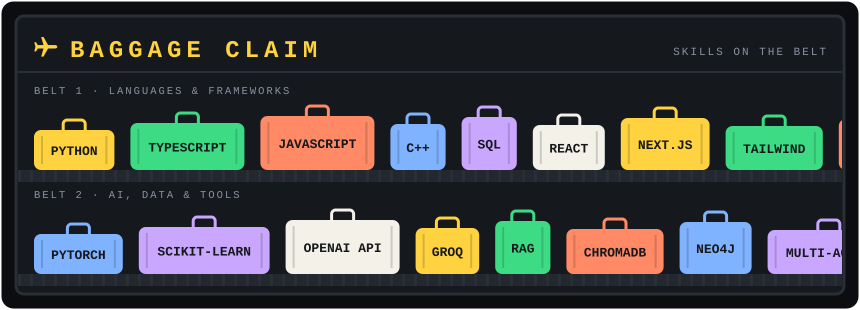

  

  
  
  

  

| Gate | Flight | Route | Boarding |
|:---:|:---|:---|:---:|
| **A1** | [**CodeInsight**](https://github.com/Nishant1600/Codeinsight) | Google Maps for software systems. Maps any repo's architecture as a live graph, answers questions and predicts bug impact. OpenAI Hackathon | [Live ↗](https://codeinsight-iota.vercel.app/) |
| **A2** | [**ORION**](https://github.com/Nishant1600/ORION) | Energy supply-chain resilience. Real-time risk intelligence from 30+ APIs and 500+ feeds across 160+ panels. | [Live ↗](https://orion-eight-beta.vercel.app/) |
| **B1** | [**AI Website Audit Team**](https://github.com/Nishant1600/ai-website-audit-team) | A company of AI agents: 10 specialists, 5 supervisors and a CEO that find, fix and double-check every bug. | Open source |
| **B2** | [**Far Away**](https://github.com/Nishant1600/Far_AWAY) | Emergency response. Cooperating agents detect incidents, allocate resources and optimise routes. | Open source |
| **B3** | [**JARVIS**](https://github.com/Nishant1600/BrainstormingJARVIS) | A voice layer for a coding agent, native on Windows, with a 3D interface and every run recorded. | Open source |
| **C1** | [**StudyHub**](https://github.com/Nishant1600/studyhub) | AI study assistant for DU FoT that answers only from your own course material, with citations. | Open source |
| **C2** | [**MediScan**](https://github.com/Nishant1600/GFG-MEDISCAN) | Privacy-preserving skin-condition screening for doctors, powered by EfficientNet-B3. GFG Hack-4-Viksit Bharat | Open source |
| **D1** | [**Learning-C**](https://github.com/Nishant1600/Learning-C) | Daily C practice, kept on record. | Daily |

  

  

  ✈ Thanks for flying NS1600 · <a href="https://www.linkedin.com/in/nishant1600/">LinkedIn</a> · <a href="mailto:nishantsharmadks@gmail.com">Email</a> · art generated by <a href="scripts/airport.py">scripts/airport.py</a>

